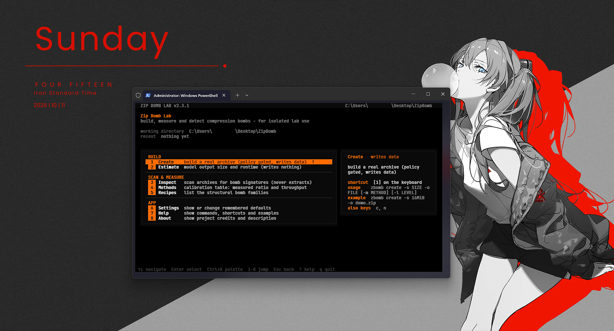
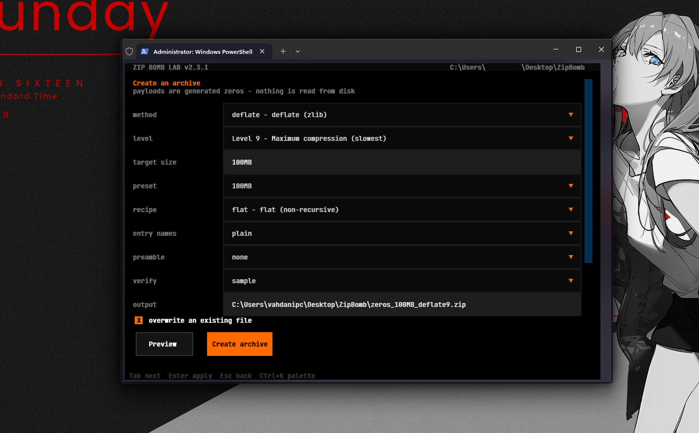
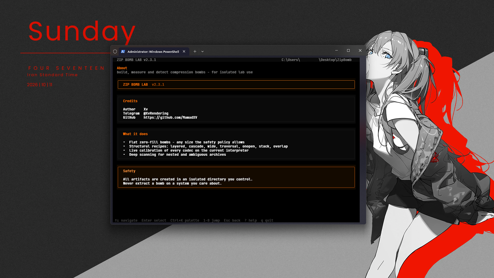

# 📦 ZipBomb Lab (`zbomb`)

**Build, measure and detect compression bombs — a safe research lab CLI**

[](https://pypi.org/project/zbomb/)
[](https://www.python.org/)
[](LICENSE)
[](https://pypi.org/project/zbomb/)

### [🇺🇸 English](#-english-version) | [🇮🇷 فارسی](#-نسخه-فارسی)

---

## 🇺🇸 English Version

Welcome to **ZipBomb Lab (`zbomb`)** — a safe research laboratory for building, measuring, and detecting compression bombs on any hardware.

> **⚠️ Disclaimer:** This is a research and educational tool. Forks of this project **must retain full credit** to the original developer (**Xv**). Use of this software is at your own responsibility.

### 🚀 Quick Start

Install in seconds from PyPI:

```bash
# 1. Install the package
pip install zbomb

# or, isolated via pipx:
pipx install zbomb

# 2. Verify the install
zbomb version

# 3. Build a tiny bomb and scan it back
zbomb create -s 16MiB
```

### ✨ Features TL;DR

- 🔬 **Build bombs** — craft compression bombs of any target size
- 📏 **Estimate expansion** — see the real expansion plan before creating anything
- 🔍 **Inspect archives** — scan any ZIP for bomb characteristics (`--deep` for full analysis)
- 📋 **Recipes & methods** — ready-made blueprints and compression-method comparisons
- 🖥️ **Interactive panel & TUI** — guided menus with live estimates

### 📸 Screenshots

<p align="center">
  
</p>

<br>

<p align="center">
  
</p>

<br>

<p align="center">
  
</p>

### 🛠️ Commands Overview

| Command | Description |
| --- | --- |
| 🔬 `zbomb create` | Build a compression bomb and scan it back |
| 📏 `zbomb estimate` | Estimate expansion for a target size |
| 🔍 `zbomb inspect` | Scan an archive for bomb characteristics |
| 📋 `zbomb recipes` | Ready-made bomb recipes |
| ⚙️ `zbomb methods` | Compare compression methods |
| 🖥️ `zbomb panel` | Interactive guided panel |
| 🧪 `zbomb demo` | Run a full demo |
| 📦 `zbomb version` | Show version |

Run `zbomb --help` for the full command overview.

### 📋 Requirements

- Python **3.9+**
- `rich>=13` and `textual>=8` (pulled in automatically by pip)

### 🧪 Run the Tests

```bash
python -m pytest tests -q
```

### 📥 From the Repository

```bash
git clone https://github.com/MamadXV/zipbomb.git
cd zipbomb
pip install .
# or development (editable) install:
pip install -e ".[dev]"
```

## *Created with 💖 by Xv.*

---

## 🇮🇷 نسخه فارسی

به **ZipBomb Lab (`zbomb`)** خوش اومدی! یه لابراتوار امن برای ساخت، اندازه‌گیری و تشخیص بمب‌های فشرده‌سازی روی هر سخت‌افزاری.

> **⚠️ توجه مهم:** این ابزار جهت پژوهش و آموزش طراحی شده. فورک‌های این پروژه **باید کردیت کامل** رو برای توسعه‌دهنده اصلی (**Xv**) حفظ کنن. کپی‌های ویرایش‌شده یا بدون کردیت اجرا نمی‌شن. استفاده از این نرم‌افزار به مسئولیت خود شماست.

### 🚀 راهنمای نصب سریع

```bash
# ۱. نصب از پای‌پی
pip install zbomb

# یا نصب ایزوله با pipx:
pipx install zbomb

# ۲. بررسی نصب
zbomb version

# ۳. ساخت یک بمب کوچک و اسکن مجدد
zbomb create -s 16MiB
```

### ✨ امکانات و قابلیت‌ها

- 🔬 **ساخت بمب** — ساخت بمب فشرده‌سازی در هر اندازه دلخواه
- 📏 **تخمین انبساط** — دیدن برنامه واقعی انبساط قبل از ساخت
- 🔍 **بازرسی آرشیو** — اسکن هر فایل ZIP با قابلیت تحلیل عمیق (`--deep`)
- 📋 **رسپی‌ها و متدها** — نقشه‌های آماده و مقایسه روش‌های فشرده‌سازی
- 🖥️ **پنل تعاملی و TUI** — منوهای راهنما با تخمین زنده
- 🎨 **تم‌های رنگی** — چندین تم رنگی مختلف
- 🔐 **سیاست ایمنی** — محدودیت‌های هوشمندانه برای پژوهش مسئولانه

### 📸 تصاویر برنامه

<p align="center">
  
</p>

<br>

<p align="center">
  
</p>

<br>

<p align="center">
  
</p>

### 🛠️ فهرست دستورات

| دستور | توضیح |
| --- | --- |
| 🔬 `zbomb create` | ساخت بمب فشرده‌سازی و اسکن مجدد |
| 📏 `zbomb estimate` | تخمین انبساط برای اندازه هدف |
| 🔍 `zbomb inspect` | بررسی آرشیو از نظر بمب فشرده‌سازی |
| 📋 `zbomb recipes` | رسپی‌های آماده بمب |
| ⚙️ `zbomb methods` | مقایسه روش‌های فشرده‌سازی |
| 🖥️ `zbomb panel` | پنل تعاملی راهنما |
| 🎨 `zbomb theme` | تغییر تم رنگی |
| 🧪 `zbomb demo` | اجرای دموی کامل |
| 🔐 `zbomb policy` | مشاهده سیاست ایمنی |
| 📦 `zbomb version` | نمایش نسخه + واترمارک نویسنده |

برای مشاهده کامل دستورات: `zbomb --help`

### 📋 پیش‌نیازها

- پایتون **نسخه ۳.۹ به بالا**
- `rich>=13` و `textual>=8` (به‌صورت خودکار توسط pip نصب می‌شن)

### 🧪 اجرای تست‌ها

```bash
python -m pytest tests -q
```

### 📥 نصب از مخزن گیت‌هاب

```bash
git clone https://github.com/MamadXV/zipbomb.git
cd zipbomb
pip install .
# یا نصب توسعه (editable):
pip install -e ".[dev]"
```

---

*ساخته شده با 💖 توسط Xv.*
